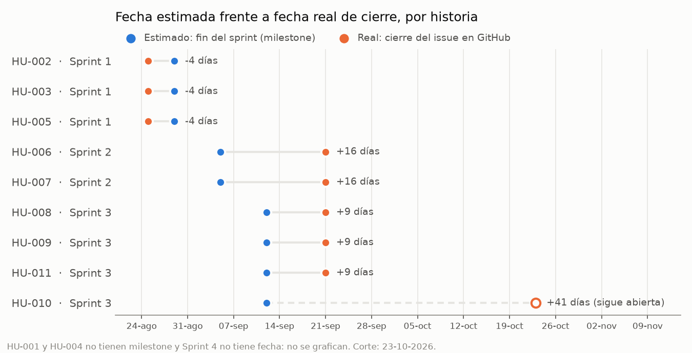
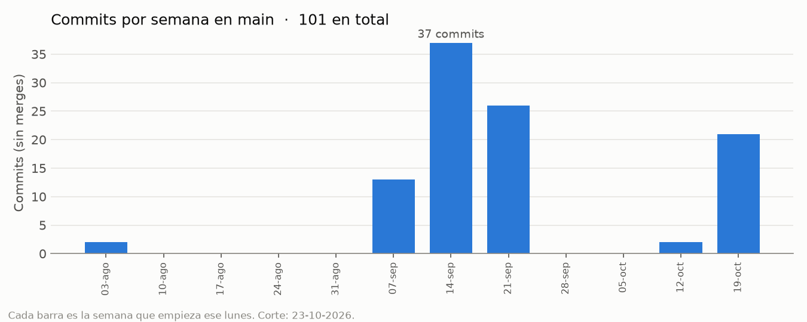
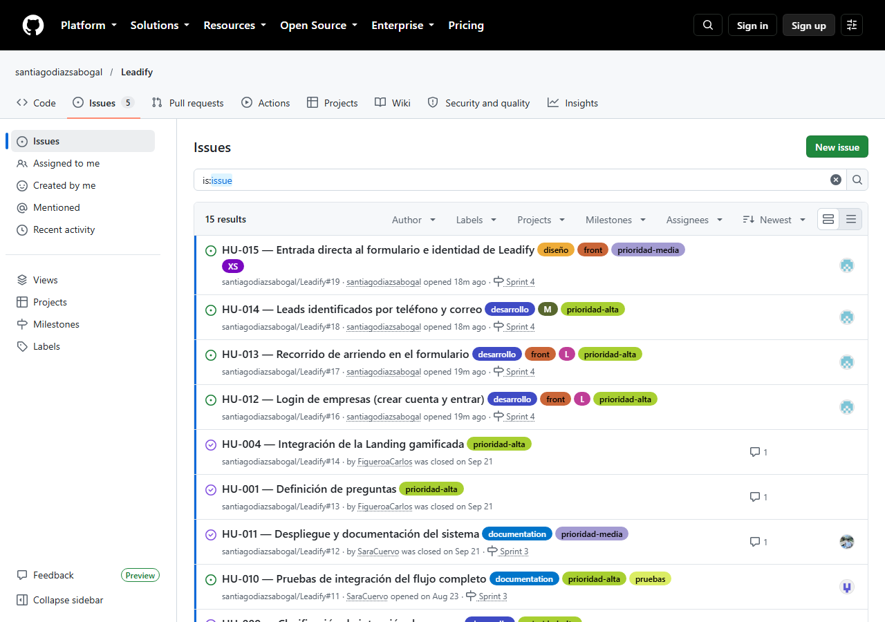
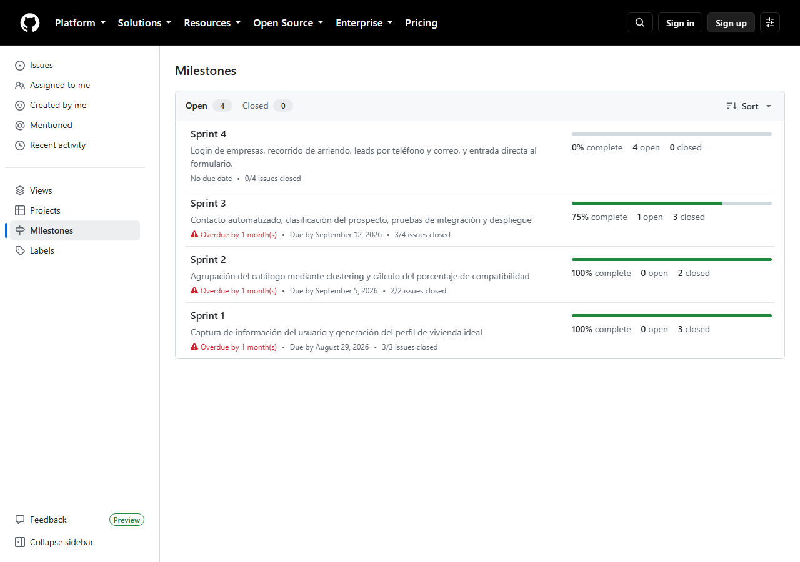
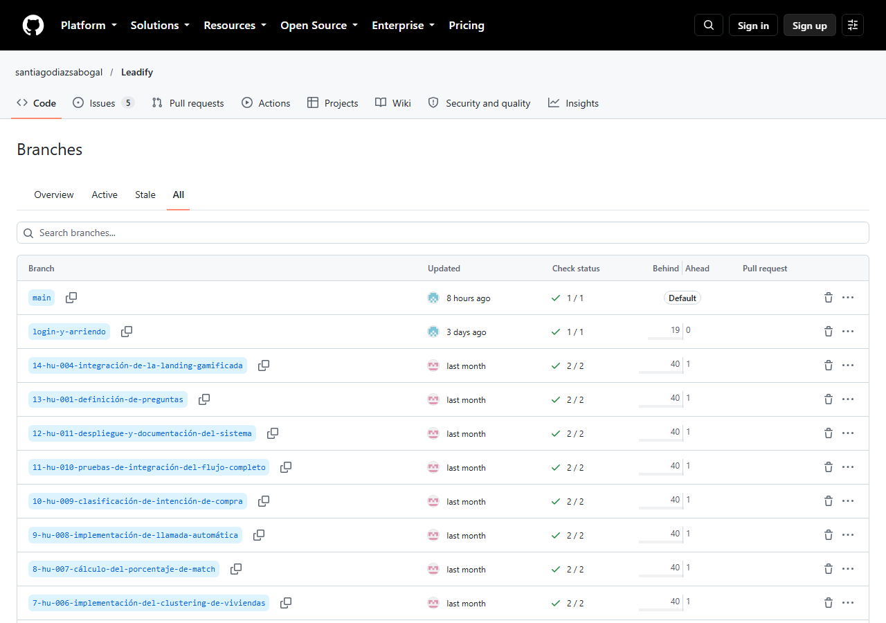
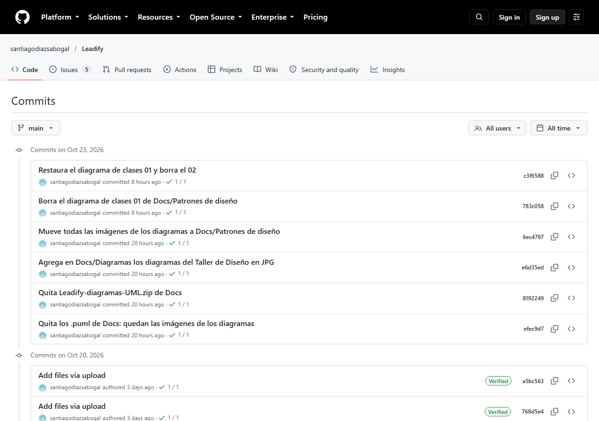

# Reporte gerencial

**Fecha de corte:** 23 de octubre de 2026
**Periodo:** Sprint 1 a Sprint 4 (agosto a octubre de 2026)
**Para:** seguimiento del proyecto — lectura sin contexto técnico previo

---

## Resumen ejecutivo

Leadify es un formulario que recomienda vivienda en Bogotá D.C. La persona
elige primero si quiere **comprar** o **arrendar**:

- **Compra:** un modelo de *machine learning* (Nearest Neighbors,
  colaborativo + contenido) ordena 96 proyectos reales de cuatro
  constructoras según el perfil de quien responde, si puede pagarlos y qué tan
  cerca quedan del barrio donde quiere vivir, medido en kilómetros reales.
- **Arriendo:** recomienda sobre un catálogo de 93 inmuebles publicados
  (30 viviendas, 32 oficinas y 31 bodegas), según la zona, el presupuesto y
  las preferencias.

Al final, la persona puede pedir que **Manuela**, una agente de voz con IA, la
llame para calificar su interés y agendar con un asesor. Las constructoras e
inmobiliarias tienen además **cuentas propias** para entrar a Leadify.

**Estado actual:**

- Formulario en producción: <https://leadify-kappa.vercel.app>. Abre
  directamente en el registro, sin pantallas previas.
- Motor de recomendación (compra y arriendo): desplegado en Render y
  verificado con datos reales.
- Llamada automática (Dapta/Manuela): conectada y probada de punta a punta.
- Base de datos de leads: Postgres en Supabase, en uso.
- **Pendiente en producción:** el login de empresas y la identificación de
  leads por teléfono y correo ya están en el código, pero falta aplicar la
  migración de la base y configurar `DATABASE_URL` en Render. Mientras tanto
  el formulario funciona, pero no guarda leads nuevos ni deja crear cuentas.

---

## Medidas usadas

| Medida | Cómo se obtiene | Para qué sirve |
|---|---|---|
| Historias cerradas / planeadas por sprint | Issues de GitHub y su milestone | Avance de cada sprint |
| Puntos de historia (estimado) | Planning poker del equipo (carpeta `estimación/`) | Esfuerzo esperado de cada historia |
| Talla de la historia (estimado) | Etiquetas `XS`, `M` y `L` en el issue | Esfuerzo esperado en el Sprint 4 |
| Fecha estimada de una historia | Fecha de fin del sprint (milestone) | Plazo comprometido |
| Fecha real de una historia | Fecha de cierre del issue en GitHub | Plazo cumplido |
| Desviación en días | Fecha real − fecha estimada | Atraso (+) o adelanto (−) |
| Commits por semana en `main` | Historial de Git, sin merges | Actividad del equipo en el código |
| Pruebas automáticas que pasan | Pruebas del login, del backend y de humo | Estabilidad del sistema |
| Tiempo de respuesta del modelo | Medido contra el servicio en producción | Experiencia de quien usa el formulario |

**Lo que no se midió:** las horas reales de trabajo. El equipo estimó en
puntos pero no registró horas, así que el esfuerzo real se aproxima con la
actividad en el repositorio (más abajo). Registrar horas por historia queda
como acción para la siguiente entrega.

---

## Estado de avance de las historias

| HU | Historia | Sprint | Responsable | Estimación | Estado |
|---|---|---|---|---|---|
| HU-001 | Definición de preguntas | — | — | 1 punto | Cerrada |
| HU-002 | Diseño del cuestionario visual | Sprint 1 | Carlos Figueroa | 2 puntos | Cerrada |
| HU-003 | Diseño de la landing gamificada | Sprint 1 | Juan Diego Ortiz | 3 puntos | Cerrada |
| HU-004 | Integración de la landing gamificada | — | — | 3 puntos | Cerrada |
| HU-005 | Construcción del perfil de vivienda ideal | Sprint 1 | Sara Cuervo | 5 puntos | Cerrada |
| HU-006 | Implementación del clustering de viviendas | Sprint 2 | Carlos Figueroa | sin estimar | Cerrada |
| HU-007 | Cálculo del porcentaje de match | Sprint 2 | Santiago Díaz | sin estimar | Cerrada |
| HU-008 | Implementación de llamada automática | Sprint 3 | Santiago Díaz | sin estimar | Cerrada |
| HU-009 | Clasificación de intención de compra | Sprint 3 | Carlos Figueroa | sin estimar | Cerrada |
| HU-010 | Pruebas de integración del flujo completo | Sprint 3 | Sara Cuervo | sin estimar | **Abierta** |
| HU-011 | Despliegue y documentación del sistema | Sprint 3 | Juan Diego Ortiz | sin estimar | Cerrada |
| HU-012 | Login de empresas (crear cuenta y entrar) | Sprint 4 | Santiago Díaz | L | **Abierta** — código listo, falta activarlo en producción |
| HU-013 | Recorrido de arriendo en el formulario | Sprint 4 | Santiago Díaz | L | **Abierta** — en producción, falta validación del Product Owner |
| HU-014 | Leads identificados por teléfono y correo | Sprint 4 | Santiago Díaz | M | **Abierta** — falta aplicar la migración de la base |
| HU-015 | Entrada directa al formulario e identidad de Leadify | Sprint 4 | Santiago Díaz | XS | **Abierta** — en producción, falta validación del Product Owner |

### Avance por sprint

| Sprint | Historias | Cerradas | Fin del sprint |
|---|---|---:|---|
| Sprint 1 | HU-002, HU-003, HU-005 | 3 / 3 (100 %) | 29-ago-2026 |
| Sprint 2 | HU-006, HU-007 | 2 / 2 (100 %) | 05-sep-2026 |
| Sprint 3 | HU-008 a HU-011 | 3 / 4 (75 %) | 12-sep-2026 |
| Sprint 4 | HU-012 a HU-015 | 0 / 4 (0 %) | sin fecha |
| Sin sprint | HU-001, HU-004 | 2 / 2 (100 %) | — |
| **Total** | **15 historias** | **10 / 15 (67 %)** | |

En el Sprint 4 todo el trabajo está hecho y en el repositorio. Ninguna
historia está cerrada todavía porque dos dependen de activar la base de
producción y las cuatro esperan la validación del Product Owner.

---

## Estimado frente a real

### Tiempos

| HU | Sprint | Estimado (fin del sprint) | Real (cierre en GitHub) | Desviación |
|---|---|---|---|---:|
| HU-002, HU-003, HU-005 | Sprint 1 | 29-ago-2026 | 25-ago-2026 | −4 días |
| HU-006, HU-007 | Sprint 2 | 05-sep-2026 | 21-sep-2026 | +16 días |
| HU-008, HU-009, HU-011 | Sprint 3 | 12-sep-2026 | 21-sep-2026 | +9 días |
| HU-010 | Sprint 3 | 12-sep-2026 | sigue abierta | +41 días al corte |

- El **Sprint 1 se cumplió antes de lo previsto**. Los Sprints 2 y 3 se
  cerraron con 9 a 16 días de atraso.
- Las ocho historias cerradas que tenían fecha se desviaron, en promedio,
  **+5,9 días** respecto a lo planeado.
- **Cuidado al leer las fechas reales:** siete historias se cerraron el mismo
  día, el 21 de septiembre. Esa fecha es la de la actualización del tablero,
  no necesariamente la de terminación: el trabajo de varias estaba listo
  antes.
- HU-001 y HU-004 no tienen sprint asignado, y el Sprint 4 todavía no tiene
  fecha de fin, así que no se pueden comparar contra un plazo.

### Esfuerzo

| Historia | Puntos estimados | Resultado |
|---|---:|---|
| HU-001 | 1 | Cerrada el 21-sep, sin sprint |
| HU-002 | 2 | Cerrada dentro del Sprint 1 |
| HU-003 | 3 | Cerrada dentro del Sprint 1 |
| HU-004 | 3 | Cerrada el 21-sep, sin sprint |
| HU-005 | 5 | Cerrada dentro del Sprint 1 |
| **Total** | **14** | **10 puntos entregados dentro del Sprint 1** |

- De los 14 puntos estimados en planning poker, **10 se entregaron dentro del
  Sprint 1**. Los otros 4 (HU-001 y HU-004) se cerraron después, sin sprint
  asignado. HU-005 fue la de mayor dispersión al estimar (votos de 3 a 8) y se
  dejó en 5 puntos tras aclarar su alcance (Daily 1).
- **HU-006 a HU-011 nunca se estimaron en puntos.** Las del Sprint 4 se
  estimaron por talla: dos L, una M y una XS.
- Como no hay horas registradas, la medida de esfuerzo real disponible es la
  actividad en el código:

- Hay **101 commits** en `main`. El esfuerzo se concentró en tres semanas:
  la del 14 de septiembre (37 commits), la del 21 de septiembre (26) y la del
  19 de octubre (21).
- Entre el 10 de agosto y el 6 de septiembre no hubo commits, aunque el
  Sprint 1 se cerró en ese periodo: ese trabajo fue de diseño y
  documentación, que no siempre pasa por el repositorio.

---

## Qué se puede medir hoy

Cifras verificadas contra el sistema, no estimadas:

| Métrica | Valor |
|---|---|
| Proyectos en el catálogo de compra | 96, de 4 constructoras |
| Inmuebles en el catálogo de arriendo | 93 (30 viviendas, 32 oficinas, 31 bodegas) |
| Proyectos recomendados por consulta de compra | 18 |
| Sectores del grafo de cercanía (barrios) | 1.164, con distancia real en km |
| Tiempo de respuesta del modelo (servicio activo) | ~1 segundo |
| Tiempo de respuesta (servicio dormido, primera consulta del día) | 30–50 segundos |
| Tablas de leads en producción | 3 (`leads`, `consultas`, `intereses`); la migración pendiente agrega las 3 de cuentas |
| Pruebas automáticas del login (frontend) | 27, todas pasan |
| Pruebas del backend (login, arriendo, llamada) | 9, todas pasan, más la prueba de humo del motor |
| Verificaciones del repositorio (`Script/`) | 3, se corren a mano |

---

## Uso de GitHub

**Issues:** las 15 historias, cada una con descripción, criterios de
aceptación, etiquetas de tipo y prioridad, y responsable.

**Milestones:** un milestone por sprint, del Sprint 1 al Sprint 4.

**Ramas:** `main`, `develop`, una rama por historia de usuario y
`login-y-arriendo` para el trabajo del Sprint 4.

**Commits:** el historial de `main`.

---

## Problemas encontrados y cómo se resolvieron

Ningún proyecto de este tamaño llega sin tropiezos. Estos son los que
tuvimos, cómo se resolvieron, y cuáles siguen abiertos:

### Resueltos

**Pérdida accidental de historial de código (dos veces).** Un `force-push`
de un integrante sobrescribió sin querer 81 commits del repositorio
compartido —incluida la verificación automática, la guía de usuario, las
capturas del formulario y parte del trabajo del modelo—. Se recuperó **sin
perder el trabajo de nadie**, combinando las dos historias en vez de forzar
una encima de la otra. No volvió a pasar desde entonces.

**El motor de recomendación no estaba conectado en producción.** El
formulario llevaba un tiempo calculando resultados con un motor de reglas
local, aproximado, en vez de con el modelo real. Se encontró la causa (el
archivo de despliegue estaba en la carpeta equivocada para que Render lo
leyera) y quedó corregido y verificado con datos reales.

**La llamada apuntaba al backend de otro proyecto.** Se creó un flujo de Dapta
propio de Leadify y el endpoint `POST /api/llamar` pasó a vivir en el backend
de Leadify (Daily 10).

**Créditos agotados en el servicio de llamadas (Dapta).** Durante las
pruebas se acabó el saldo gratuito. Se creó una cuenta y un flujo nuevos, se
reconectaron las credenciales, y se confirmó que la llamada se dispara
correctamente de extremo a extremo.

**Las rutas del motor dependían de la estructura vieja del repositorio.** Se
centralizaron en `Model/rutas.py`, para cambiarlas en un solo lugar
(Daily 6).

**Render no permite enviar correos en el plan gratuito.** Eso descartaba la
confirmación de correo al crear una cuenta. Se decidió que las cuentas de
empresa queden activas al crearlas, sin confirmación ni revisión manual
(Daily 11).

**Los leads se identificaban por cédula.** El formulario dejó de pedirla y
ahora identifica a cada persona por teléfono y correo. Los registros
anteriores no se podían pasar a la llave nueva sin adivinar, porque un mismo
teléfono aparecía con varias cédulas, así que la migración los archiva en un
esquema cerrado en vez de borrarlos (Daily 12).

**La base de datos se pausó por inactividad.** El plan gratuito de Supabase
pausa el proyecto tras una semana sin uso, y en ese tiempo el formulario no
guardó leads. Se reactivó el 20 de octubre.

### Abiertos — requieren una decisión o una acción del equipo

**Falta activar el Sprint 4 en producción.** Hay que aplicar las migraciones
de `Database/migraciones/` en Supabase y configurar `DATABASE_URL` en Render.
Hasta entonces no se guardan leads nuevos ni se pueden crear cuentas.

**La protección de la rama principal está desactivada.** Tras el incidente
del `force-push` se activó una protección que lo habría evitado; luego se
desactivó a pedido del equipo. Hoy `main` puede volver a sobrescribirse sin
darse cuenta. **Recomendación:** reactivarla antes de la entrega final.

**La verificación automática en GitHub se retiró.** Corría cuatro
comprobaciones en cada `push`; se quitó a pedido del equipo. Hoy las
comprobaciones de `Script/` y las pruebas se corren a mano.

**Las ramas de cada historia no tienen commits propios.** Existe una rama por
historia, pero todas apuntan al mismo commit y van 40 commits detrás de
`main`; el trabajo se hizo directamente en `main` y en `login-y-arriendo`.

**No hay recuperación de contraseña.** Sin envío de correos, quien olvide su
contraseña no puede recuperarla por su cuenta. Está asumido por la limitación
del plan gratuito de Render.

**El plan gratuito del servicio de recomendación se "duerme".** Tras 15
minutos sin uso, la primera consulta del día tarda 30–50 segundos en
responder — no es un error, es la condición del plan sin costo. El sistema
ya tiene una red de seguridad (cae a un motor local aproximado si el
servicio no responde a tiempo), pero para una demostración en vivo conviene
despertarlo un par de minutos antes.

**El catálogo de arriendo depende del formato de Fincaraíz.** Si el portal
cambia sus páginas, el scraper deja de funcionar. El catálogo generado queda
versionado en el repositorio como respaldo (Daily 14).

**El desglose de lenguajes de GitHub no refleja el código real.** Hoy GitHub
muestra solo PL/pgSQL y Python, aunque el repositorio también tiene
JavaScript, TypeScript y CSS. Es un problema cosmético tras las reescrituras
de historial; no afecta el funcionamiento de nada.

---

## Pendiente para la siguiente entrega

- Aplicar las migraciones de la base y configurar `DATABASE_URL` en Render
- Validar con el Product Owner y cerrar HU-012 a HU-015
- Cerrar formalmente HU-010 con la evidencia de las pruebas ya realizadas
- Poner fecha de fin al Sprint 4 y asignar sprint a HU-001 y HU-004
- Estimar en puntos las historias que no lo están y registrar horas reales
- Reactivar la protección de la rama `main`
- Organigrama visual del equipo
